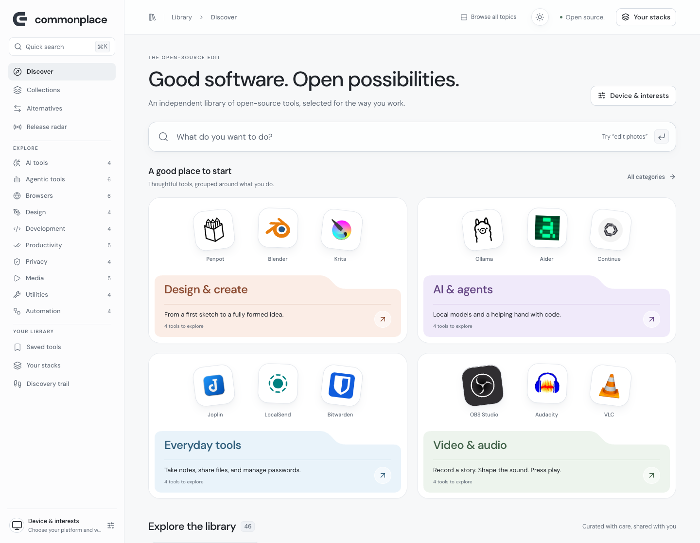

# Commonplace

**Good software. Open possibilities.**

An independent, open-source library of useful software. Discover tools for your operating system, compare alternatives, and build a personal toolkit in a fast, responsive interface.

[](https://github.com/saketh12e/commonplace/actions/workflows/quality.yml)
[](LICENSE)



## What you can do

- Browse **46 tools across 10 categories**, including AI, agents, browsers, design, privacy and everyday utilities.
- Search by task, name or alternative; filter by platform, offline use and self-hosting.
- Explore curated collections and compare up to three tools side by side.
- Save tools, create personal stacks, export a stack and revisit your discovery history.
- Read selected upstream release snapshots with official source links.
- Choose Light, Dark or System appearance, with keyboard navigation and reduced-motion support.

Search and recommendations use curated data and deterministic matching. Personal preferences and collections stay in your browser; there are no accounts or cross-device sync. Release radar contains reviewed snapshots, not a live feed. AI assistance and automated submissions are future work.

## Get started

Use **Node.js 22.12+** (Node 22 is used in CI) and npm. No API keys or external services are required.

```sh
git clone https://github.com/saketh12e/commonplace.git
cd commonplace
npm ci
npm run dev
```

Open [localhost:5173](http://127.0.0.1:5173/). With nvm, run `nvm use` before installing dependencies.

| Command                | Purpose                                               |
| ---------------------- | ----------------------------------------------------- |
| `npm run dev`          | Start the development server                          |
| `npm run check`        | Type-check, run the tests and build production assets |
| `npm run format:check` | Check source, docs and repository formatting          |
| `npm run format`       | Apply the shared formatting rules                     |
| `npm run test:watch`   | Run tests while developing                            |
| `npm run build`        | Create the production bundle in `dist/`               |
| `npm run preview`      | Preview the production bundle at localhost:4173       |

## Contribute

Code, catalog improvements, accessibility fixes and documentation contributions are welcome. Start with [CONTRIBUTING.md](CONTRIBUTING.md), then open a focused pull request. You can also [report a bug, propose a feature or suggest a tool](https://github.com/saketh12e/commonplace/issues/new/choose).

Contributors can fork the repository and submit a PR without collaborator access. Invited collaborators can work on feature branches in this repository. CI runs formatting, TypeScript, catalog validation, unit tests and a production build for every PR. A maintainer reviews changes before merging.

GitHub is the current contribution channel. The website's direct submission/DM workflow remains unconnected; it does not send messages or publish tools automatically.

## Project map

```text
src/
  components/       Shared controls, navigation, dialogs and category folders
  pages/            Discover, collections, comparison, stacks, history and updates
  data/             Curated catalog, categories, topics, collections and releases
  lib/              Matching, providers, browser storage and export
  styles/           Theme tokens and component/route styles
public/
  brand/            Commonplace identity
  logos/            Local tool artwork
  platforms/        Platform identifiers and attribution
  licenses/         Retained font and icon license notices
docs/               Architecture, design decisions and catalog sources
.github/            CI, issue forms, PR template and dependency updates
```

- [Architecture and data ownership](docs/architecture.md)
- [Current discovery design](docs/design-v5.md) and [validation notes](docs/validation-v5.md)
- [Catalog sources](docs/catalog-sources.md), [expanded catalog sources](docs/catalog-v2-sources.md) and [release sources](docs/releases-v3-sources.md)
- [Security reporting](SECURITY.md) and [community conduct](CODE_OF_CONDUCT.md)

Historical design/validation documents describe their own iteration. Raw research, browser installations and local screenshots under `work/` and `output/` are excluded from Git; they are not required to build or contribute.

## Hosting

This repository contains a static React application built with TypeScript and Vite. A host must serve `dist/`, provide an SPA fallback to `/index.html`, and use HTTPS. See the [deployment boundary](docs/architecture.md#deployment-boundary). Publishing this repository does not deploy the website.

## License and attribution

Commonplace's original code and documentation are [MIT licensed](LICENSE). Tool names, logos, font files and other third-party materials retain their own licenses and trademark rights; see [THIRD_PARTY_NOTICES.md](THIRD_PARTY_NOTICES.md). Listing a project does not imply endorsement.
